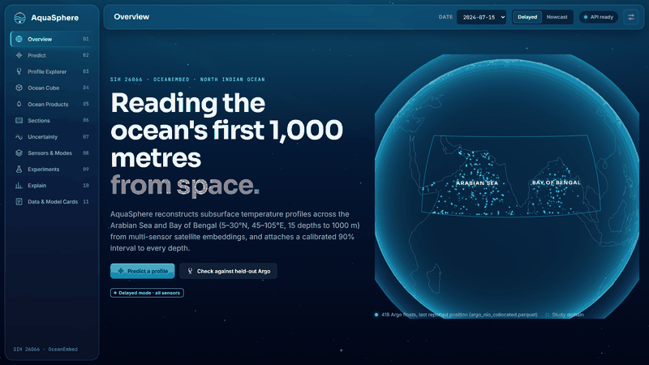
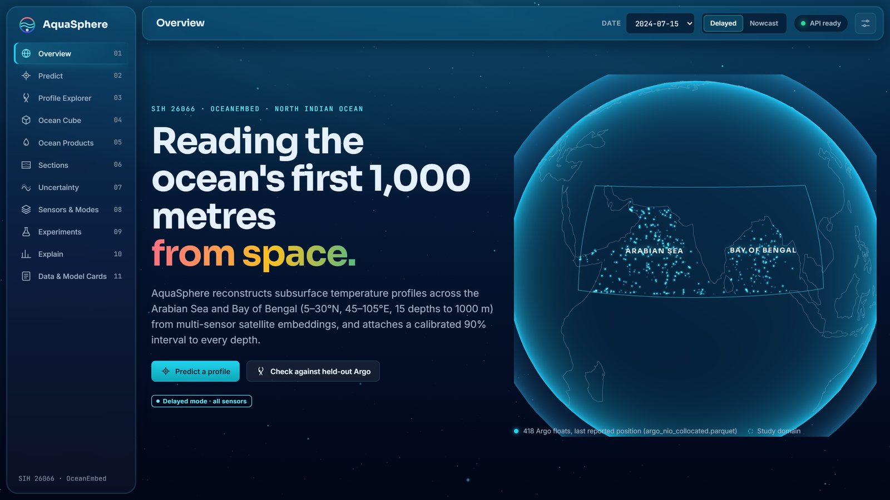
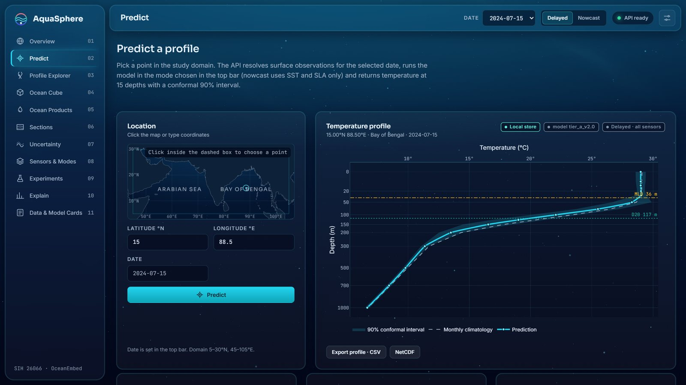
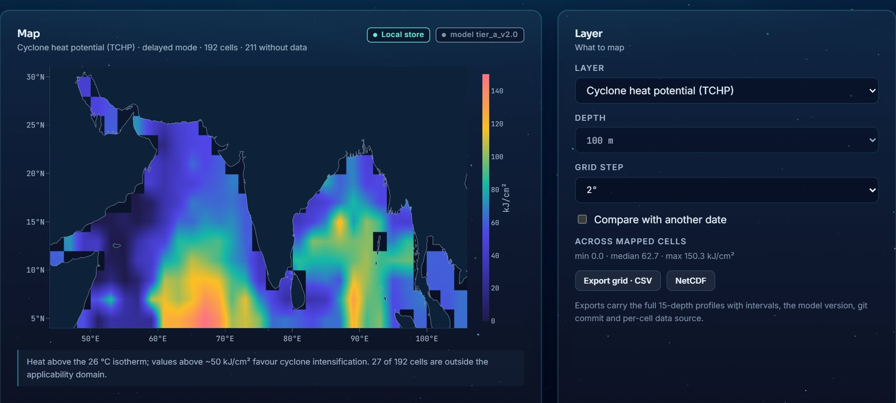
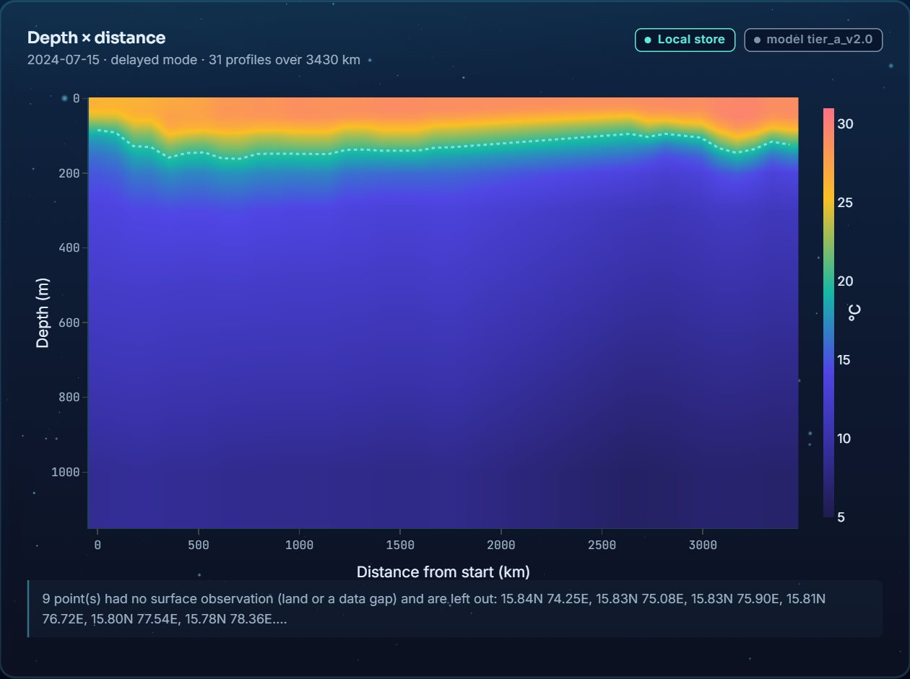
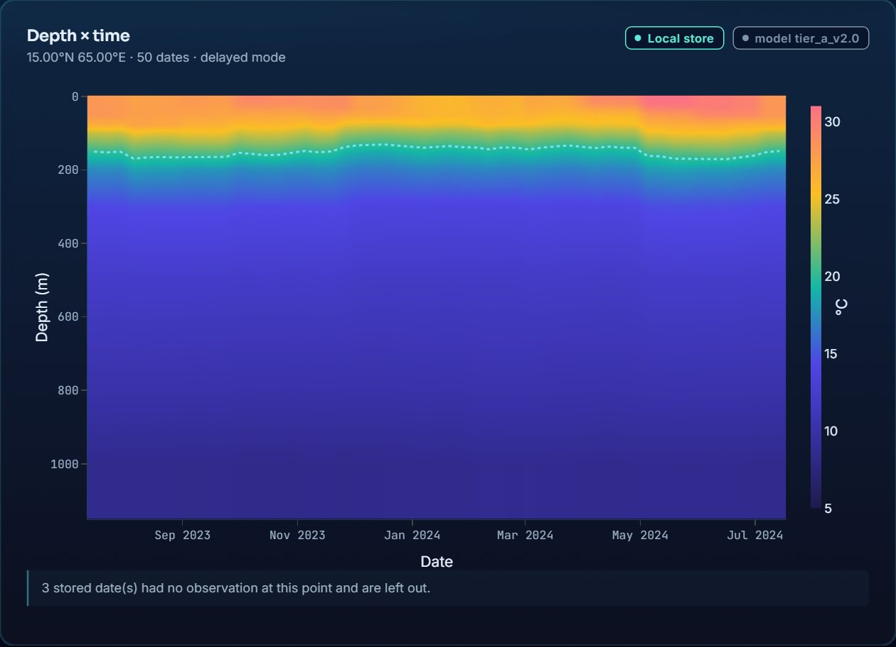
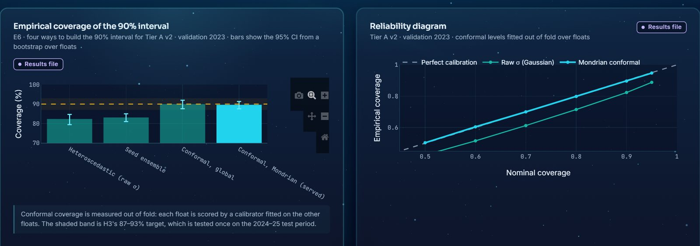
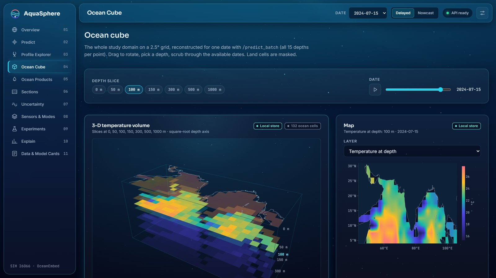
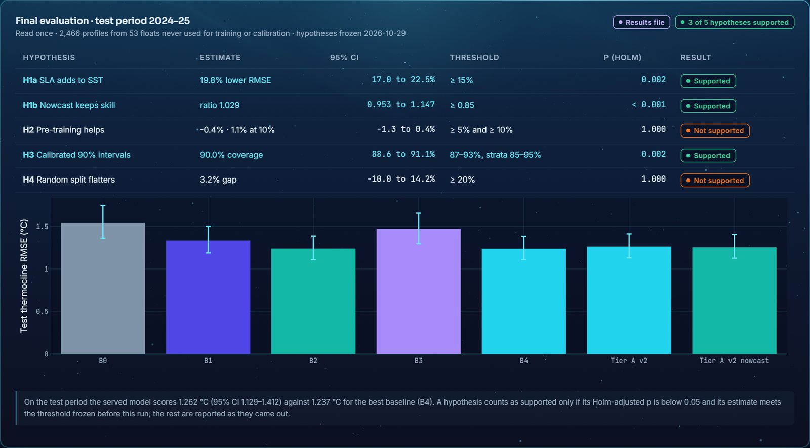
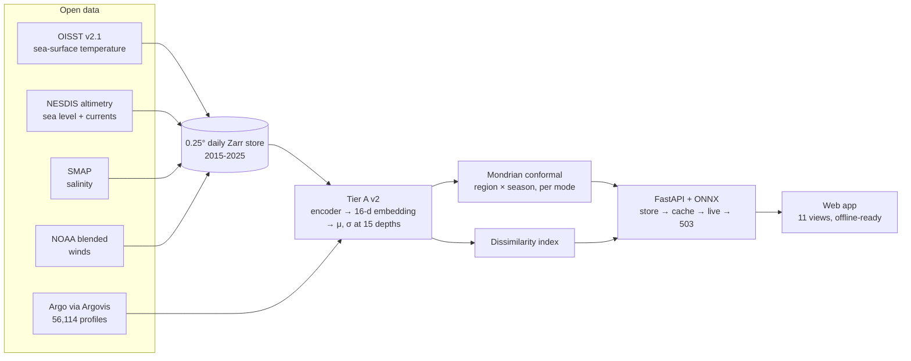

<div align="center">

# 🌊 AquaSphere

**Reading the North Indian Ocean's first 1,000 metres from space, with uncertainty you can trust.**

Subsurface temperature reconstructed from daily satellite observations, with a calibrated 90% interval at every depth, a real-time nowcast mode and a flag for inputs it has never seen.

[](https://github.com/FarhanAaqil/AquaSphere/actions/workflows/ci.yml)
[](LICENSE)
[](pyproject.toml)
[](https://github.com/FarhanAaqil/AquaSphere/releases/tag/v1.0.0)
[](#)



[Quick start](#-quick-start) · [Screenshots](#-the-interface) · [Results](#-results) · [How it works](#-how-it-works) · [API](#-api) · [Docs](#-documentation)

</div>

---

## Why

Argo floats measure ocean temperature down to 1,000 m, but the North Indian Ocean has only a few hundred of them, each surfacing every ten days. Satellites see the whole ocean every day, but only its skin. **AquaSphere learns the link between the two**, so that for any point and day it can estimate the full temperature profile from surface observations alone.

It was built for **Smart India Hackathon problem statement 26066** (Ministry of Earth Sciences / INCOIS): the Arabian Sea and Bay of Bengal, 5-30°N and 45-105°E, at 15 depths from the surface to 1,000 m.

## ✨ What you get

| Feature | What it means |
|---|---|
| 🌡️ **A full profile** | Temperature at 15 depths, plus mixed-layer depth, the 20 °C and 26 °C isotherm depths and upper-ocean heat content |
| 🎯 **A calibrated 90% band** | Conformal intervals calibrated separately for each region and monsoon season; **90.0% coverage** on the test period |
| ⚡ **Nowcast mode** | Runs on SST and sea level alone, the inputs available in real time, and **keeps all of its skill** |
| 🧭 **An applicability flag** | A dissimilarity index warns when the inputs look unlike anything in training |
| 🌀 **Ocean products** | Cyclone heat potential, anomaly maps, transects, depth-time sections, two-date comparisons, CSV/NetCDF export |
| 🛡️ **Honesty by design** | Every chart names its data source; a missing observation is a "Data unavailable", never a guess; the app works offline and says so |

## 🖥️ The interface

Every screenshot below is the running app on real 2015-2025 data, captured during the final click-through test (49 of 49 checks passed in Chrome).

<table>
<tr>
<td width="50%"><br><b>Overview</b> · a globe with the 418 Argo floats, the headline results, and a scroll-driven descent from the surface to 1,000 m.</td>
<td width="50%"><br><b>Predict</b> · click anywhere for a profile with its 90% band, isotherm depths, cyclone heat potential and an applicability check.</td>
</tr>
<tr>
<td><br><b>Ocean Products</b> · cyclone heat potential, the 26 °C isotherm, anomalies, interval width and the dissimilarity index, with a two-date compare mode.</td>
<td><br><b>Sections</b> · a depth × distance transect between any two clicks, with the 20 °C isotherm traced on it.</td>
</tr>
<tr>
<td><br><b>Depth-time</b> · follow one point through a year of the stored record.</td>
<td><br><b>Uncertainty</b> · four ways to build the band compared, and a reliability diagram that sits on the diagonal.</td>
</tr>
<tr>
<td><br><b>Ocean Cube</b> · stacked temperature slices for the whole domain, with a date player.</td>
<td><br><b>Experiments</b> · the one test-period verdict on each frozen hypothesis, next to the baseline ladder.</td>
</tr>
</table>

Eleven views in all, also including the Profile Explorer (predictions against 2023 Argo profiles the model never saw), Sensors & Modes, Explain and Data & Model Cards. The interface is vanilla ES modules with three.js, GSAP and Plotly vendored: no build step, no CDN calls, and it keeps working offline.

## 📊 Results

The test period, **2024-2025**, was locked during development and **read exactly once**, against five hypotheses frozen in advance. It covers 2,466 Argo profiles from 53 floats that never appear in training or calibration.

| Model | Thermocline RMSE, 50-150 m (°C) | 95% CI | Skill vs climatology |
|---|---:|---:|---:|
| B0 Climatology (2015-2022) | 1.539 | 1.36-1.74 | 0.000 |
| B1 Climatology + ridge | 1.333 | 1.19-1.50 | 0.249 |
| B2 Climatology + LightGBM | 1.239 | 1.11-1.39 | 0.352 |
| B3 v1 network, retrained | 1.470 | 1.30-1.66 | 0.087 |
| B4 Deep ensemble (5 networks) | 1.237 | 1.11-1.38 | 0.354 |
| **AquaSphere Tier A v2 (served)** | **1.262** | 1.13-1.41 | 0.327 |
| AquaSphere, nowcast mode | 1.253 | 1.13-1.41 | 0.336 |

| Frozen hypothesis | Estimate (95% CI) | Threshold | Holm p | |
|---|---|---|---|:---:|
| H1a Adding sea level to SST lowers thermocline error | 19.8% (17.0-22.5%) | ≥ 15% | 0.002 | ✅ |
| H1b Nowcast keeps the full-sensor skill | ratio 1.03 (0.95-1.15) | ≥ 0.85 | < 0.001 | ✅ |
| H2 Self-supervised pre-training helps | -0.4% / +1.1% | ≥ 5% / ≥ 10% | 1.0 | ❌ |
| H3 The 90% intervals are calibrated | 90.0% coverage (88.6-91.1%) | 87-93% | 0.002 | ✅ |
| H4 A random split flatters error by ≥ 20% | 3.2% (-10.0-14.2%) | ≥ 20% | 1.0 | ❌ |

**In plain terms:**
- AquaSphere is as accurate as the strongest baselines, not more accurate.
- What it adds is calibrated intervals by regime, a nowcast mode that loses nothing, an applicability flag, and the products and interface around them.
- **Weak spot:** the Bay of Bengal in the NE monsoon is under-covered at 80% (23 floats, descriptive only).
- **Independent check:** at the RAMA moorings, which no model ever saw, the error is 1.08 °C against 1.05 °C for climatology. At fixed sites it does not beat climatology yet.
- **Negative results reported:** the 9×9 patch encoder and the pre-training were both tested; neither earned a place.

Full tables: [`docs/results/final_eval.md`](docs/results/final_eval.md) · validation experiments: [`docs/results/phase4.md`](docs/results/phase4.md) · moorings: [`docs/results/e8_rama.md`](docs/results/e8_rama.md)

## 🚀 Quick start

```bash
git clone https://github.com/FarhanAaqil/AquaSphere.git && cd AquaSphere
pip install -e ".[dev,onnx]"
```

A fresh clone has the code and results but not the data or weights. Download them from the [**v1.0.0 release**](https://github.com/FarhanAaqil/AquaSphere/releases/tag/v1.0.0) into `dist/release/`, then:

```bash
python scripts/package_release.py --verify                     # checks SHA256SUMS
tar -xzf dist/release/aquasphere-model-tier_a_v2.tar.gz        # trained model (2 MB)
tar -xzf dist/release/aquasphere-nio-store-2015-2025.tar.gz    # satellite store (870 MB)
tar -xzf dist/release/aquasphere-argo-nio.tar.gz               # Argo tables (21 MB)
python -m uvicorn aquasphere.serve.app:app --port 8000
```

Open **http://127.0.0.1:8000**. The status pill should read *API ready*, and the server picks up the trained model and the real store automatically.

<details>
<summary><b>Rebuild everything from open data instead (about 3 hours)</b></summary>

```bash
make reproduce                 # or: python scripts/reproduce.py   (no make needed)
make regression                # the served checkpoint reproduces its recorded numbers
```

A rebuild from a clean clone reproduced every committed number exactly. `python scripts/reproduce.py --list` prints every step.
</details>

<details>
<summary><b>Docker</b></summary>

```bash
docker build -t aquasphere .
docker run -p 8000:8000 -v "$PWD/checkpoints:/app/checkpoints" -v "$PWD/data/store:/app/data/store" aquasphere
```
</details>

## 🔬 How it works



1. **Data.** Five open NOAA products are fetched from ERDDAP onto a 0.25° daily grid for 2015-2025. Missing days stay missing. Argo profiles get quality control, pressure-to-depth conversion and interpolation to the 15 standard depths.
2. **Model.** 18 inputs per point: position, season, seven sensors and an availability flag for each. A residual MLP encodes them into a 16-dimensional embedding, and a decoder predicts the anomaly from a training-years climatology, with a mean and a variance at every depth. 30% of training samples see only SST and sea level, so one network serves both modes.
3. **Uncertainty.** Split-conformal quantiles are fitted on 2023, separately for the Arabian Sea and Bay of Bengal in each monsoon season. The embedding also drives the applicability flag.
4. **Evaluation (protocol v2).** Train on 2015-2022, calibrate on 2023, test on 2024-2025, with every float in only one period. Hypotheses were frozen under a git tag before tuning. The test partition sits behind an unlock phrase and an access log, which holds exactly one entry. Statistics use a float-block bootstrap, Holm correction and a power analysis per stratum.
5. **Serving.** FastAPI with an honest resolver that tries the local store, then the disk cache, then a live ERDDAP fetch, and otherwise returns an explicit 503. ONNX inference is verified against torch at load. Gzip, ETags, Prometheus metrics and rate limiting are built in.

## 🔌 API

Interactive docs are at `/docs`. The v1 routes keep their contract; v2 adds products.

| Route | What it returns |
|---|---|
| `GET /predict?lat&lon&date&mode=delayed\|nowcast` | One profile with its 90% interval, MLD, D20, D26, TCHP, `di`, `in_domain` |
| `POST /predict_batch`, `POST /v2/predict_batch` | Up to 5,000 points (v2 lists points without data instead of failing) |
| `GET /v2/grid?date&depth&step&mode` | Map layers: temperature, anomaly, σ, interval width, MLD, D20, D26, TCHP, DI |
| `GET /v2/transect`, `GET /v2/timeseries` | Depth × distance and depth × time sections |
| `GET /v2/export/profile`, `GET /v2/export/grid` | CSV or NetCDF with a provenance header |
| `GET /v2/drift` | Domain-mean dissimilarity over time |
| `GET /validation/profile` | Nearest held-out Argo profile with prediction and RMSE |
| `GET /health`, `/ready`, `/meta`, `/metrics` | Liveness, readiness and provenance, metadata, Prometheus |

```bash
curl "http://127.0.0.1:8000/predict?lat=15&lon=65&date=2024-07-15&mode=nowcast"
```

## 🧪 Quality

- **CI on every push and pull request:** ruff, mypy, about 270 tests with an 80% coverage gate, 40 Playwright browser tests including WCAG 2.1 AA checks, a dependency audit, a Docker build and a smoke training run.
- **Numbers cannot drift silently:** a regression gate re-scores the served model, and CI fails if any results file changes without being re-frozen.
- **A full click-through in real Chrome** (`python scripts/walkthrough.py`) covers every tab, control and export, plus opening the app with the API stopped.

```bash
pytest tests/ --cov=aquasphere --cov-fail-under=80
pytest tests/e2e --no-cov          # needs: python -m playwright install chromium
```

## 📁 Repository layout

```text
AquaSphere/
├── src/aquasphere/
│   ├── data/        ERDDAP fetch, Argovis ingest, QC, collocation, patches, Zarr store
│   ├── models/      Tier A encoder/decoder, patch CNN, masked autoencoder, losses
│   ├── train/       Protocol v2 training core, Mondrian conformal
│   ├── eval/        Splits and test lock, metrics, baselines, experiments, final evaluation, RAMA
│   └── serve/       FastAPI app, v2 routes, resolver, engine, ONNX, ops middleware
├── web/             The interface (vanilla ES modules, service worker, vendored libraries)
├── tests/           Unit, ML, data, API and browser tests
├── scripts/         Web data, freeze, regression, release, reproduce, walkthrough
├── docs/            README images and the generated results files
└── Makefile         serve · reproduce · eval-phase4 · eval-rama · regression · release
```

## 📚 Results files

Every number on the site and in this README is generated by the pipeline into [`docs/results/`](docs/results), never typed by hand, and CI fails if any of them changes without being re-frozen.

| File | Contents |
|---|---|
| [`final_eval.md`](docs/results/final_eval.md) | The one test-period run: hypothesis verdicts, test ladder, coverage by region and season |
| [`phase4.md`](docs/results/phase4.md) | Validation experiments: sensor ablation, patch encoder, pre-training curves, calibration methods, nowcast |
| [`baseline_table_v2.md`](docs/results/baseline_table_v2.md) | Baseline ladder B0-B4 under protocol v2 |
| [`e1_leakage_v2.md`](docs/results/e1_leakage_v2.md) | How much a random split flatters each model |
| [`e8_rama.md`](docs/results/e8_rama.md) | Independent check against RAMA moorings |
| [`data_coverage.md`](docs/results/data_coverage.md) | What the 2015-2025 store and Argo archive contain |
| [`test_access.log`](docs/results/test_access.log) | The single read of the test period |

## ⚠️ Limitations

- **Accuracy:** level with LightGBM and a deep ensemble on the test period, not ahead.
- **Moorings:** no better than climatology at the RAMA moorings.
- **Bay of Bengal in winter:** intervals under-cover (80%), and its strata are too thin for confirmatory claims.
- **Real-time SST untested:** nowcast mode was evaluated on the final SST release, not the preliminary near-real-time one.
- **A research prototype:** not validated for navigation, safety-critical offshore work or search and rescue without independent INCOIS verification.

## 🙏 Acknowledgements

- **Data:** sea-surface temperature, altimetry, salinity and winds come from NOAA ERDDAP (NCEI OISST v2.1, NOAA/NESDIS, NASA SMAP via CoastWatch, NOAA Blended Sea Winds).
- **Argo:** profiles come via [Argovis](https://argovis.colorado.edu). They were collected and made freely available by the International Argo Program and the national programs that contribute to it.
- **Moorings:** RAMA data come from NOAA PMEL's Global Tropical Moored Buoy Array.

## 📄 License

[MIT](LICENSE) © 2026 Farhan Aaqil
