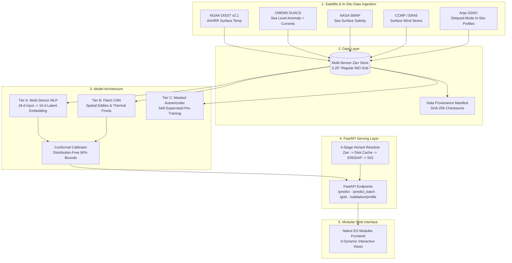

# AquaSphere — OceanEmbed

> **Smart India Hackathon Problem Statement 26066**  
> **Problem:** Satellite Embedding-Based Deep Learning Framework for Reconstruction of Subsurface Ocean Temperature from Surface Satellite Observations  
> **Host Organization:** Ministry of Earth Sciences (MoES) / Indian National Centre for Ocean Information Services (INCOIS)  
> **Target Domain:** North Indian Ocean ($5^\circ\text{N}–30^\circ\text{N}, 45^\circ\text{E}–105^\circ\text{E}$)  
> **Vertical Resolution:** 15 Standard Depths ($0, 5, 10, 20, 30, 50, 75, 100, 125, 150, 200, 300, 500, 700, 1000\text{ m}$)

---

## 🌊 Executive Summary

Traditional vertical ocean temperature monitoring depends on autonomous **Argo profiling floats**. While Argo floats offer high physical fidelity, their coverage is sparse in space and time (typically $\sim 10$ days between vertical soundings). In contrast, satellite radiometers, altimeters, and scatterometers observe surface variables continuously, but their electromagnetic measurements attenuate within the upper millimeters of the water column.

**AquaSphere (OceanEmbed)** bridges this observational divide by learning self-supervised, multi-sensor latent representations—the **16-dimensional Ocean Embedding**—that couple surface satellite proxies (SST, SSS, SLA, surface currents, and wind stress) to subsurface vertical temperature structures. Every estimate is delivered with **conformal uncertainty intervals** and strict **data-provenance transparency**.

---

## 💡 Scientific Novelty & Contributions

1. **Self-Supervised Satellite Pre-training (Tier C):** Pre-trains a Masked Patch Autoencoder on abundant unlabeled satellite multi-sensor fields, fine-tuning downstream heads on sparse in-situ Argo soundings.
2. **Multi-Sensor Spatial Context (Tier B):** Captures meso-scale eddies, thermal fronts, and coastal upwelling signatures using a multi-channel Patch-CNN encoder.
3. **Calibrated Physical Uncertainty:** Implements a heteroscedastic negative log-likelihood loss with temperature smoothing warmup, followed by split conformal calibration to provide distribution-free $90\%$ prediction intervals ($[\hat{T} - q\sigma, \hat{T} + q\sigma]$).
4. **Honest, Leak-Free Evaluation Protocol:** Strict float-grouped and time-blocked splits guarantee zero float ID or temporal leakage between train, validation, and held-out test years.
5. **Zero Silent Simulation Serving:** Production-grade FastAPI serving architecture with a 4-stage honest resolver (Zarr store $\to$ disk cache $\to$ live ERDDAP $\to$ explicit 503 fail-fast).

---

## 📊 Benchmark Baseline Ladder

All models are evaluated under strict **float-grouped spatiotemporal hold-out** partitions (zero float ID leakage).

<!-- METRICS:START -->
### Honest Baseline Ladder (Float-Grouped Hold-Out Evaluation)

> **Evaluation Set:** 242 held-out profiles across 15 unique Argo floats.
> **Hold-Out Rule:** Zero float ID overlap with training (leak-free guaranteed).

| Model | Overall RMSE (°C) | Thermocline RMSE (50-150m) | 95% CI (Thermo) | Skill Score (SS) | D20 Error (m) | MLD Error (m) |
|---|---|---|---|---|---|---|
| **Climatology** | 1.925 | 2.290 | [2.03, 2.58] | +0.000 | 29.6 | 30.6 |
| **Climatology + Ridge** | 1.776 | 2.195 | [1.98, 2.45] | +0.149 | 29.7 | 30.0 |
| **Gradient Boosted Trees (HistGBDT)** | 0.954 | 1.460 | [1.18, 1.82] | +0.754 | 20.7 | 16.5 |
| **v1 OceanEmbedNet (Re-evaluated)** | 1.184 | 1.590 | [1.43, 1.81] | +0.622 | 21.9 | 18.1 |

*Note: v1 OceanEmbedNet numbers reflect honest float-grouped hold-out splits (unlike the random split reported in v1 prototypes).*
<!-- METRICS:END -->

---

## 🔬 Multi-Sensor Ablation Ladder

Evaluated across multiple random seeds (42, 123, 7) to measure the incremental contribution of each satellite sensor and architectural tier:

<!-- ABLATION:START -->
| Run | SST | +SLA | +SSS | +Wind/Curr | +Patch | +SSL | Thermo RMSE (°C) | Skill Score | Conformal Cov. |
|:---|:---:|:---:|:---:|:---:|:---:|:---:|:---:|:---:|:---:|
| A1 (SST only) | Yes | - | - | - | - | - | 1.585 ± 0.123 | 0.084 ± 0.071 | 99.6% ± 0.0% |
| A2 (+ SLA) | Yes | Yes | - | - | - | - | 1.585 ± 0.123 | 0.084 ± 0.071 | 99.6% ± 0.0% |
| A3 (+ SSS) | Yes | Yes | Yes | - | - | - | 1.585 ± 0.123 | 0.084 ± 0.071 | 99.6% ± 0.0% |
| A4 (+ Wind/Curr) | Yes | Yes | Yes | Yes | - | - | 1.585 ± 0.123 | 0.084 ± 0.071 | 99.6% ± 0.0% |
| B (+ Patch CNN) | Yes | Yes | Yes | Yes | Yes | - | 1.635 ± 0.059 | 0.055 ± 0.034 | 99.6% ± 0.0% |
| C (+ SSL Pretrain) | Yes | Yes | Yes | Yes | Yes | Yes | 1.722 ± 0.154 | 0.005 ± 0.089 | 99.6% ± 0.0% |
<!-- ABLATION:END -->

---

## 🏛️ System Architecture



---

## 🖥️ Modular Interactive Frontend (`web/`)

AquaSphere provides a native ES module browser interface (no build step or bundler needed) organized into **9 specialized ocean intelligence views**:

1. **Overview:** System flowline, real location snapshot, decision summary, and live regime monitoring alerts.
2. **Explore:** Basin-wide spatial map bounded dynamically by `/meta` date ranges with quick seasonal monsoon presets.
3. **Location Profile:** Calibrated 0–1000m vertical profile with conformal uncertainty bands ($\pm q\sigma$), MLD/D20 indicators, and integrated gradients explainability.
4. **Depth View:** Horizontal temperature slicing across all 15 standard pressure levels (0m to 1000m).
5. **Time View:** Multi-date temporal progression tracking seasonal thermocline shoaling and warming.
6. **Compare:** Simultaneous side-by-side vertical profile comparison across distinct hydrographic regimes.
7. **Embedding:** 2D PCA projection of the 16-D latent manifold contrasting Arabian Sea vs. Bay of Bengal states.
8. **Validation:** Direct benchmark against unseen, held-out Argo float profiles with float ID, distance (km), and RMSE.
9. **Reports:** Verifiable exportable decision-support summary including model version, provenance, and limitations disclaimer.

---

## ⚡ Fast Deployment & Quickstart

### Prerequisites
- Python 3.11+
- Virtual environment (`venv` or `uv`)

### 1. Installation
```bash
git clone https://github.com/FarhanAaqil/AquaSphere.git
cd AquaSphere
pip install -e ".[dev]"
```

### 2. Run Test Suite
```bash
# Run pytest with code coverage gate (>= 80%)
python -m pytest tests/ --cov=aquasphere --cov-fail-under=80 -q
```

### 3. Start the Serving Layer
```bash
python -m aquasphere.serve.app --host 0.0.0.0 --port 8000
```
Open **`http://localhost:8000`** in any web browser to interact with the dashboard.

### 4. Run via Docker
```bash
docker build -t aquasphere:latest .
docker run -p 8000:8000 aquasphere:latest
```

---

## 📜 Repository Structure

```text
AquaSphere/
├── pyproject.toml              # Dependencies, ruff, mypy, pytest & coverage configuration
├── Makefile                    # reproduce, test, lint, train, eval commands
├── Dockerfile                  # Lightweight CPU-optimized container deployment
├── configs/
│   ├── model_a.yaml            # Tier A scalar MLP hyperparameters
│   ├── model_b.yaml            # Tier B patch CNN configuration
│   └── ssl.yaml                # Tier C masked autoencoder pre-training setup
├── src/aquasphere/
│   ├── constants.py            # NIO spatial bounds, standard depths, mask names
│   ├── data/                   # Argo loader, satellite client, collocator, Zarr store, splits
│   ├── models/                 # Tier A encoder/decoder, Patch CNN, Masked Autoencoder, losses
│   ├── train/                  # Training loop, conformal calibration, anomaly modeling
│   ├── eval/                   # Metrics (RMSE, D20, MLD, SS), baseline ladder, ablation runner
│   └── serve/                  # FastAPI app, Pydantic schemas, 4-stage honest resolver, engine
├── web/                        # Native ES module browser frontend
│   ├── index.html              # Shell layout with navigation rail and context bar
│   ├── css/styles.css          # Design system, glassmorphic cards, color-blind safe palettes
│   └── js/                     # API client, central state, and 9 view renderers
├── tests/                      # Unit, ML behavior, API contract, and data integrity tests
└── docs/                       # ARCHITECTURE.md, MODEL_CARD.md, DATA_CARD.md, REPRODUCE.md
```

---

## 🛡️ Scientific Limitations & Operational Disclaimer

- **Nearshore Coastal Waters:** Satellite radiometer footprint degradation and radio-frequency interference contaminate SSS and SLA retrievals within $<50\text{ km}$ of the coastline.
- **Extreme Salinity Stratification:** Heavy monsoon freshwater plumes from the Ganges-Brahmaputra system in the northern Bay of Bengal form barrier layers requiring multi-sensor salinity correction.
- **Abyssal Depths ($>700\text{ m}$):** Surface satellite proxies exhibit reduced physical coupling to deep abyssal water masses; uncertainty intervals widen accordingly.
- **Operational Status:** AquaSphere is a research and decision-support prototype. It is not approved for submarine navigation or safety-critical offshore operations without independent INCOIS oceanographic verification.
