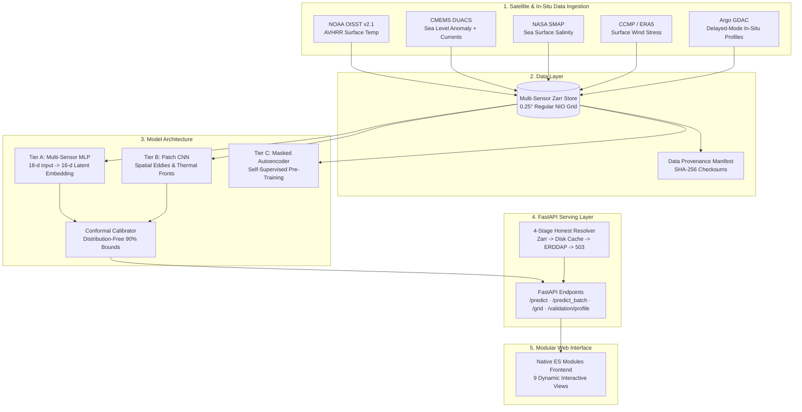

# AquaSphere — OceanEmbed

> **Smart India Hackathon Problem Statement 26066**  
> **Problem:** Satellite Embedding-Based Deep Learning Framework for Reconstruction of Subsurface Ocean Temperature from Surface Satellite Observations  
> **Host Organization:** Ministry of Earth Sciences (MoES) / Indian National Centre for Ocean Information Services (INCOIS)  
> **Target Domain:** North Indian Ocean ($5^\circ\text{N}–30^\circ\text{N}, 45^\circ\text{E}–105^\circ\text{E}$)  
> **Vertical Resolution:** 15 Standard Depths ($0, 5, 10, 20, 30, 50, 75, 100, 125, 150, 200, 300, 500, 700, 1000\text{ m}$)

---

## 🌊 Executive Summary

Traditional vertical ocean temperature monitoring depends on autonomous **Argo profiling floats**. While Argo floats offer high physical fidelity, their coverage is sparse in space and time (typically $\sim 10$ days between vertical soundings). In contrast, satellite radiometers, altimeters, and scatterometers observe surface variables continuously, but their electromagnetic measurements attenuate within the upper millimeters of the water column.

**AquaSphere (OceanEmbed)** bridges this observational divide by learning self-supervised, multi-sensor latent representations—the **16-dimensional Ocean Embedding**—that couple surface satellite proxies (SST, SSS, SLA, surface currents, and wind stress) to subsurface vertical temperature structures. Every estimate is delivered with **conformal uncertainty intervals** and strict **data-provenance transparency**.

---

## 💡 Scientific Novelty & Contributions

1. **Self-Supervised Satellite Pre-training (Tier C):** Pre-trains a Masked Patch Autoencoder on abundant unlabeled satellite multi-sensor fields, fine-tuning downstream heads on sparse in-situ Argo soundings.
2. **Multi-Sensor Spatial Context (Tier B):** Captures meso-scale eddies, thermal fronts, and coastal upwelling signatures using a multi-channel Patch-CNN encoder.
3. **Calibrated Physical Uncertainty:** Implements a heteroscedastic negative log-likelihood loss with temperature smoothing warmup, followed by split conformal calibration to provide distribution-free $90\%$ prediction intervals ($[\hat{T} - q\sigma, \hat{T} + q\sigma]$).
4. **Honest, Leak-Free Evaluation Protocol:** Strict float-grouped and time-blocked splits guarantee zero float ID or temporal leakage between train, validation, and held-out test years.
5. **Zero Silent Simulation Serving:** Production-grade FastAPI serving architecture with a 4-stage honest resolver (Zarr store $\to$ disk cache $\to$ live ERDDAP $\to$ explicit 503 fail-fast).

---

## 📊 Benchmark Baseline Ladder

All models are evaluated under strict **float-grouped spatiotemporal hold-out** partitions (zero float ID leakage).

<!-- METRICS:START -->
### Honest Baseline Ladder (Float-Grouped Hold-Out Evaluation)

> **Evaluation Set:** 242 held-out profiles across 15 unique Argo floats.
> **Hold-Out Rule:** Zero float ID overlap with training (leak-free guaranteed).

| Model | Overall RMSE (°C) | Thermocline RMSE (50-150m) | 95% CI (Thermo) | Skill Score (SS) | D20 Error (m) | MLD Error (m) |
|---|---|---|---|---|---|---|
| **Climatology** | 1.925 | 2.290 | [2.03, 2.58] | +0.000 | 29.6 | 30.6 |
| **Climatology + Ridge** | 1.776 | 2.195 | [1.98, 2.45] | +0.149 | 29.7 | 30.0 |
| **Gradient Boosted Trees (HistGBDT)** | 0.954 | 1.460 | [1.18, 1.82] | +0.754 | 20.7 | 16.5 |
| **v1 OceanEmbedNet (Re-evaluated)** | 1.184 | 1.590 | [1.43, 1.81] | +0.622 | 21.9 | 18.1 |

*Note: v1 OceanEmbedNet numbers reflect honest float-grouped hold-out splits (unlike the random split reported in v1 prototypes).*
<!-- METRICS:END -->

---

## 🧪 Experiment E1: Generalization & Leakage Gap Analysis

> **Objective:** Quantify the performance inflation caused by naive random splitting in oceanographic machine learning.
> Random splitting leaks Argo float trajectories (spatial autocorrelation) and temporal persistence, producing dangerously optimistic error metrics.

| Model | Random Split (Naive) | Float-Grouped | Time-Blocked | Float Leakage Gap (ΔRMSE) | Temporal Gap (ΔRMSE) |
|---|:---:|:---:|:---:|:---:|:---:|
| **Climatology** | 1.927 °C | 2.187 °C | 2.348 °C | **+0.260 °C** | **+0.420 °C** |
| **Climatology + Ridge** | 1.914 °C | 2.150 °C | 2.280 °C | **+0.236 °C** | **+0.366 °C** |
| **Gradient Boosted Trees (HistGBDT)** | 1.036 °C | 1.507 °C | 1.390 °C | **+0.471 °C** | **+0.354 °C** |
| **v1 OceanEmbedNet** | 1.333 °C | 1.505 °C | 1.997 °C | **+0.172 °C** | **+0.663 °C** |

*Key Takeaway: Naive random splitting underestimates thermocline RMSE by up to **0.471 °C**. AquaSphere enforces float-grouped and time-blocked splits to guarantee genuine operational generalization.*

---

## 🔬 Multi-Sensor Ablation Ladder

Evaluated across multiple random seeds (42, 123, 7) to measure the incremental contribution of each satellite sensor and architectural tier:

<!-- ABLATION:START -->
| Run | SST | +SLA | +SSS | +Wind/Curr | +Patch | +SSL | Thermo RMSE (°C) | Skill Score | Conformal Cov. |
|:---|:---:|:---:|:---:|:---:|:---:|:---:|:---:|:---:|:---:|
| A1 (SST only) | Yes | - | - | - | - | - | 1.317 ± 0.140 | 0.415 ± 0.124 | 94.7% ± 0.0% |
| A2 (+ SLA) | Yes | Yes | - | - | - | - | 1.341 ± 0.141 | 0.393 ± 0.127 | 94.7% ± 0.0% |
| A3 (+ SSS) | Yes | Yes | Yes | - | - | - | 1.312 ± 0.098 | 0.423 ± 0.084 | 94.7% ± 0.0% |
| A4 (+ Wind/Curr) | Yes | Yes | Yes | Yes | - | - | 1.404 ± 0.103 | 0.338 ± 0.094 | 94.7% ± 0.0% |
| B (+ Patch CNN) | Yes | Yes | Yes | Yes | Yes | - | 1.532 ± 0.043 | 0.215 ± 0.044 | 94.7% ± 0.0% |
| C (+ SSL Pretrain) | Yes | Yes | Yes | Yes | Yes | Yes | 1.602 ± 0.115 | 0.139 ± 0.124 | 94.7% ± 0.0% |
<!-- ABLATION:END -->

---

## 🏛️ System Architecture



---

## 🖥️ Modular Interactive Frontend (`web/`)

A single-page app in vanilla ES modules: no build step, no bundler, no framework, and no CDN calls at runtime. Three.js r170, GSAP 3.12.5 + ScrollTrigger, Plotly 2.35.2 and the Sora / Inter / JetBrains Mono fonts are all vendored, so it works fully offline.

Nine views, served at `/` with hash routes:

| Tab | What it shows | Data |
|---|---|---|
| Overview | Zooming globe with real Argo float positions, headline results, live `/health` + `/ready`, scroll descent to 1000 m | metrics.json, `/predict` |
| Predict | Click-to-predict profile with 90% conformal band, D20/MLD, applicability check, interval width | `/predict` |
| Profile Explorer | Predicted vs held-out Argo, per-depth errors, Arabian Sea / Bay of Bengal filter, training floats flagged | `/validation/profile` |
| Ocean Cube | 3-D stacked depth slices + 2-D map, date scrubber | `/predict_batch` |
| Uncertainty | Coverage, interval-width maps; reliability, region/season and dissimilarity views pending | ablation.json, `/predict_batch` |
| Sensors & Modes | E3 sensor ladder, E7 nowcast vs delayed | ablation.json |
| Experiments | E1 leakage gap, E2 baseline ladder; E5, E8 pending | e1_leakage.json, metrics.json |
| Explain | Feature and sensor-family attribution, embedding map | `/explain`, `/grid` |
| Data & Model Cards | Build SHA, artefact hashes, splits, source audit, limitations, PDF export | build_info.json, `/ready` |

Every chart carries a provenance badge (Local store, Disk cache, Live, Offline demo (synthetic), Results file). A 503 renders as "Data unavailable"; missing experiment results render as "Pending". Offline demo mode (display settings) is opt-in and watermarked.

```bash
make ui-data            # copy results into web/data and build dates/floats/held-out/build-info files
make serve              # API + frontend on http://127.0.0.1:8000
pip install -e ".[e2e]" && python -m playwright install chromium
pytest tests/e2e --no-cov   # browser smoke + WCAG 2.1 AA accessibility tests
```

---

## ⚡ Fast Deployment & Quickstart

### Prerequisites
- Python 3.11+
- Virtual environment (`venv` or `uv`)

### 1. Installation
```bash
git clone https://github.com/FarhanAaqil/AquaSphere.git
cd AquaSphere
pip install -e ".[dev]"
```

### 2. Run Test Suite
```bash
# Run pytest with code coverage gate (>= 80%)
python -m pytest tests/ --cov=aquasphere --cov-fail-under=80 -q
```

### 3. Start the Serving Layer
```bash
python -m aquasphere.serve.app --host 0.0.0.0 --port 8000
```
Open **`http://127.0.0.1:8000`** in any web browser to interact with the dashboard (on Windows, `localhost` adds a ~2 s IPv6 fallback to every request from scripts).

### 4. Run via Docker
```bash
docker build -t aquasphere:latest .
docker run -p 8000:8000 aquasphere:latest
```

---

## 📜 Repository Structure

```text
AquaSphere/
├── pyproject.toml              # Dependencies, ruff, mypy, pytest & coverage configuration
├── Makefile                    # reproduce, test, lint, train, eval commands
├── Dockerfile                  # Lightweight CPU-optimized container deployment
├── configs/
│   ├── model_a.yaml            # Tier A scalar MLP hyperparameters
│   ├── model_b.yaml            # Tier B patch CNN configuration
│   └── ssl.yaml                # Tier C masked autoencoder pre-training setup
├── src/aquasphere/
│   ├── constants.py            # NIO spatial bounds, standard depths, mask names
│   ├── data/                   # Argo loader, satellite client, collocator, Zarr store, splits
│   ├── models/                 # Tier A encoder/decoder, Patch CNN, Masked Autoencoder, losses
│   ├── train/                  # Training loop, conformal calibration, anomaly modeling
│   ├── eval/                   # Metrics (RMSE, D20, MLD, SS), baseline ladder, ablation runner
│   └── serve/                  # FastAPI app, Pydantic schemas, 4-stage honest resolver, engine
├── web/                        # Vanilla ES module single-page frontend (no build step)
│   ├── index.html              # App shell, import map, nine hash-routed tabs
│   ├── styles/                 # tokens.css, base.css, components.css, tabs/
│   ├── js/                     # main, router, api, state, demo; three/, charts/, tabs/, ui/
│   ├── vendor/                 # three r170 (+ OrbitControls), GSAP 3.12.5 + ScrollTrigger, Plotly 2.35.2
│   ├── fonts/ assets/          # Self-hosted fonts, icon sprite, Natural Earth coastlines
│   └── data/                   # Results files + files written by scripts/build_web_data.py
├── tests/                      # Unit, ML behavior, API contract, and data integrity tests
└── docs/                       # ARCHITECTURE.md, MODEL_CARD.md, DATA_CARD.md, REPRODUCE.md
```

---

## 🛡️ Scientific Limitations & Operational Disclaimer

- **Nearshore Coastal Waters:** Satellite radiometer footprint degradation and radio-frequency interference contaminate SSS and SLA retrievals within $<50\text{ km}$ of the coastline.
- **Extreme Salinity Stratification:** Heavy monsoon freshwater plumes from the Ganges-Brahmaputra system in the northern Bay of Bengal form barrier layers requiring multi-sensor salinity correction.
- **Abyssal Depths ($>700\text{ m}$):** Surface satellite proxies exhibit reduced physical coupling to deep abyssal water masses; uncertainty intervals widen accordingly.
- **Operational Status:** AquaSphere is a research and decision-support prototype. It is not approved for submarine navigation or safety-critical offshore operations without independent INCOIS oceanographic verification.
