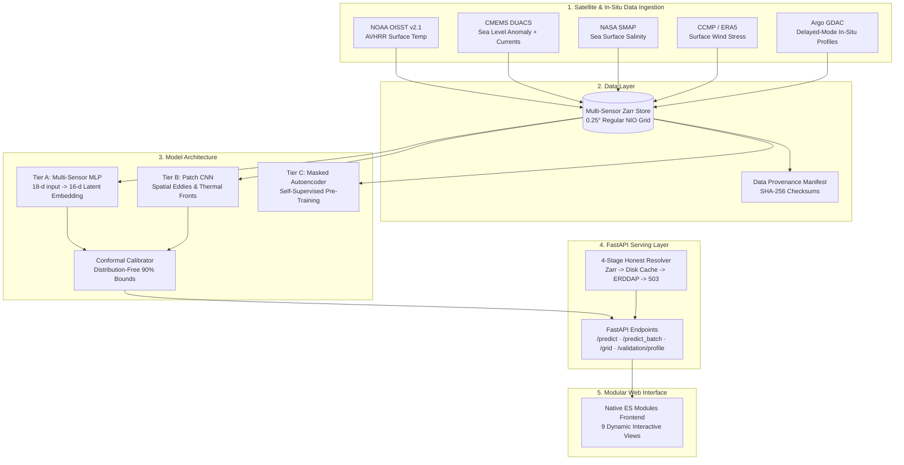

# AquaSphere — OceanEmbed

> **Smart India Hackathon Problem Statement 26066**  
> **Problem:** Satellite Embedding-Based Deep Learning Framework for Reconstruction of Subsurface Ocean Temperature from Surface Satellite Observations  
> **Host Organization:** Ministry of Earth Sciences (MoES) / Indian National Centre for Ocean Information Services (INCOIS)  
> **Target Domain:** North Indian Ocean ($5^\circ\text{N}–30^\circ\text{N}, 45^\circ\text{E}–105^\circ\text{E}$)  
> **Vertical Resolution:** 15 Standard Depths ($0, 5, 10, 20, 30, 50, 75, 100, 125, 150, 200, 300, 500, 700, 1000\text{ m}$)

---

## 🌊 Executive Summary

Argo floats measure the ocean's temperature down to 1000 m, but they are sparse: a few hundred
floats for the whole North Indian Ocean, each surfacing every ten days. Satellites see the
surface every day but nothing below it. **AquaSphere** learns the link between the two: from
satellite sea-surface temperature, sea-level anomaly, salinity, currents and winds it
reconstructs the temperature at 15 depths, with a calibrated 90% interval at every depth, a flag
for inputs unlike anything it was trained on, and a nowcast mode that needs only the sensors
available in real time.

Everything is built from open data (NOAA ERDDAP, Argovis) and evaluated the way the project
blueprint asks: train 2015-2022, calibrate 2023, and a 2024-2025 test period that was locked and
then read exactly once, against hypotheses frozen in advance. Negative results are reported.

---

## 📊 Results on the test period 2024-2025 (read once)

2,466 Argo profiles from 53 floats that never appear in training or calibration. Thermocline =
50-150 m RMSE; 95% CIs from a bootstrap over floats. Full tables: `docs/results/final_eval.md`.

| Model | Thermocline RMSE (°C) | 95% CI | Skill vs climatology |
|---|---|---|---|
| B0 Climatology (2015-2022, 2° monthly) | 1.539 | 1.36-1.74 | 0.000 |
| B1 Climatology + ridge | 1.333 | 1.19-1.50 | 0.249 |
| B2 Climatology + LightGBM | 1.239 | 1.11-1.39 | 0.352 |
| B3 v1 network, retrained | 1.470 | 1.30-1.66 | 0.087 |
| B4 Deep ensemble (5 networks) | 1.237 | 1.11-1.38 | 0.354 |
| **AquaSphere Tier A v2 (served)** | **1.262** | 1.13-1.41 | 0.327 |
| AquaSphere, nowcast mode (SST + SLA only) | 1.253 | 1.13-1.41 | 0.336 |

The served model is level with the strongest baselines rather than better than them. What it adds
is in the hypotheses below: calibrated intervals in every region and season, a nowcast mode that
keeps all of its skill, and an applicability flag.

| Frozen hypothesis | Estimate (95% CI) | Threshold | Holm p | Result |
|---|---|---|---|---|
| H1a Adding SLA to SST lowers thermocline RMSE | 19.8% (17.0-22.5%) | >= 15% | 0.002 | **supported** |
| H1b Nowcast keeps the full-sensor skill | ratio 1.03 (0.95-1.15) | >= 0.85 | < 0.001 | **supported** |
| H2 Self-supervised pre-training helps | -0.4% (full labels), +1.1% (10%) | >= 5%, >= 10% | 1.0 | not supported |
| H3 90% intervals are calibrated | 90.0% coverage (88.6-91.1%) | 87-93% | 0.002 | **supported** |
| H4 A random split flatters by >= 20% | 3.2% (-10.0-14.2%) | >= 20% | 1.0 | not supported |

- **Coverage by stratum:** 87.1-92.6% in five of six region x season strata; the Bay of Bengal NE
  monsoon covers 80.0% (descriptive only, 23 floats).
- **Applicability flag:** 6.9% of test profiles fall outside the domain, and their error is
  higher (1.45 °C vs 1.25 °C inside).
- **Independent check (E8, RAMA moorings):** 1.08 °C against 1.05 °C for climatology over 5,334
  daily sensor values; at fixed moorings the model does not beat climatology.
- **Not shipped, reported:** the 9x9 patch encoder (worse than point features on validation) and
  pre-training (H2).

---

## 💡 What AquaSphere does

1. **One model, two modes.** Nowcast (SST + SLA, available within hours) and delayed (all
   sensors) from the same network, trained with sensor masking.
2. **Calibrated intervals by regime.** Split-conformal intervals calibrated separately for the
   Arabian Sea and Bay of Bengal in each monsoon season, per depth and per mode.
3. **Applicability domain.** A dissimilarity index in embedding space flags inputs unlike
   anything in training, on every prediction and as a map.
4. **Ocean products.** Cyclone heat potential, 20 °C and 26 °C isotherm depths, anomalies,
   transects, depth-time sections and CSV/NetCDF export with provenance.
5. **Honest serving.** Local store, disk cache, live ERDDAP, then an explicit 503: missing data is
   never filled in, every chart carries its data source, and the app works offline with saved
   results clearly labelled.

---

## 🧪 Evaluation protocol

| Step | What |
|---|---|
| Splits | Train 2015-2022, validation/calibration 2023, test 2024-2025; each float belongs to the first period it appears in |
| Freeze | Hypotheses and thresholds in `docs/hypotheses.yaml`, tagged `hypotheses-v1-2026-10-29` before any tuning |
| Lock | The test partition needs an unlock phrase; every read is logged (`docs/results/test_access.log` has one line) |
| Tests | Float-block bootstrap, Holm correction over the five hypotheses, power analysis per stratum |
| Checks | `make regression` re-scores the served checkpoint; result-file hashes are frozen and checked in CI |

Validation (2023) experiments: `docs/results/phase4.md` (sensor ablation E3, patch encoder E4,
pre-training curves E5, calibration methods E6, nowcast E7). Baseline ladder and leakage gap:
`docs/results/baseline_table_v2.md`, `docs/results/e1_leakage_v2.md`.

---

## 🏛️ System Architecture



---

## 🖥️ Modular Interactive Frontend (`web/`)

A single-page app in vanilla ES modules: no build step, no bundler, no framework, and no CDN calls at runtime. Three.js r170, GSAP 3.12.5 + ScrollTrigger, Plotly 2.35.2 and the Sora / Inter / JetBrains Mono fonts are all vendored, so it works fully offline.

Eleven views, served at `/` with hash routes. The top-bar mode switch (Delayed / Nowcast) is sent to every prediction:

| Tab | What it shows | Data |
|---|---|---|
| Overview | Zooming globe with real Argo float positions, headline results, live `/health` + `/ready`, scroll descent to 1000 m | metrics.json, `/predict` |
| Predict | Click-to-predict profile with 90% conformal band, D20/MLD/TCHP, dissimilarity index, applicability check, CSV/NetCDF export | `/predict`, `/v2/export/profile` |
| Profile Explorer | Predicted vs held-out Argo, per-depth errors, Arabian Sea / Bay of Bengal filter, training floats flagged | `/validation/profile` |
| Ocean Cube | 3-D stacked depth slices + 2-D map, date scrubber | `/predict_batch` |
| Ocean Products | Cyclone heat potential, D26/D20/MLD, temperature and anomaly at a depth, interval width, dissimilarity; compare two dates; grid export | `/v2/grid`, `/v2/export/grid` |
| Sections | Transect (depth x distance) between two clicks; depth x time (Hovmoller) at a point | `/v2/transect`, `/v2/timeseries` |
| Uncertainty | E6 calibration comparison, reliability diagram, Mondrian coverage by region x season, dissimilarity map, drift monitor, interval-width maps | phase4.json, `/v2/grid`, `/v2/drift` |
| Sensors & Modes | E3 sensor ladder with paired differences and strata, E7 nowcast vs delayed | phase4.json |
| Experiments | E1 leakage gap, E2 baseline ladder, E4 patch encoder, physics-term ablation, E5 learning curves; E8 pending | metrics_v2.json, phase4.json |
| Explain | Feature and sensor-family attribution, embedding map | `/explain`, `/grid` |
| Data & Model Cards | Build SHA, artefact hashes, splits, source audit, limitations, PDF export | build_info.json, `/ready` |

Every chart carries a provenance badge (Local store, Disk cache, Live, Offline demo (synthetic), Results file). A 503 renders as "Data unavailable"; missing experiment results render as "Pending". Offline demo mode (display settings) is opt-in and watermarked.

### API v2

The v1 routes keep their contract; every addition is a new optional field or a new route.

| Route | Purpose |
|---|---|
| `GET /predict?mode=delayed\|nowcast` (also `/predict_batch`, `/grid`) | Nowcast withholds salinity, winds and currents (they arrive days late). Responses add `mode`, `interval_method`, `tchp`, `d26`, `di`, `in_domain` |
| `GET /v2/meta` | Served protocol, modes, interval method, dissimilarity threshold, ONNX in use |
| `GET /v2/grid?date&depth&step&mode` | Map layers: temperature, anomaly, sigma, interval width, MLD, D20, D26, TCHP, DI |
| `GET /v2/transect?lat1&lon1&lat2&lon2&date&n` | Depth x distance section along the great circle |
| `GET /v2/timeseries?lat&lon&start&end&step_days` | Depth x time at one point, local-store dates only |
| `GET /v2/export/profile`, `/v2/export/grid` (`format=csv\|netcdf`) | Profiles with intervals and a provenance header (model, git commit, data source) |
| `GET /v2/drift?start&end&step_days` | Mean dissimilarity of the domain over time against the training data |
| `GET /metrics` | Prometheus metrics (requests, latency histogram, 429s, readiness) |

Every response is gzip-compressed when large, carries an `ETag` (a repeat request with `If-None-Match` gets a 304), an `X-Request-ID`, and one JSON access-log line. Clients are rate limited per IP (`AQUASPHERE_RATE_LIMIT` per minute, default 600). With `pip install -e ".[onnx]"` and `make onnx`, the Tier A v2 network is served by onnxruntime after a parity check against torch. Cells, points or dates without a surface observation are left out and listed, never filled in.

```bash
make ui-data            # copy results into web/data and build dates/floats/held-out/build-info files
make serve              # API + frontend on http://127.0.0.1:8000
pip install -e ".[e2e]" && python -m playwright install chromium
pytest tests/e2e --no-cov   # browser smoke + WCAG 2.1 AA accessibility tests
```

---

## ⚡ Fast Deployment & Quickstart

### Prerequisites
- Python 3.11+
- Virtual environment (`venv` or `uv`)

### 1. Installation
```bash
git clone https://github.com/FarhanAaqil/AquaSphere.git
cd AquaSphere
pip install -e ".[dev]"
```

### 2. Run Test Suite
```bash
# Run pytest with code coverage gate (>= 80%)
python -m pytest tests/ --cov=aquasphere --cov-fail-under=80 -q
```

### 3. Start the Serving Layer
```bash
python -m aquasphere.serve.app --host 0.0.0.0 --port 8000
```
A fresh clone has no data or weights, so the API serves untrained weights and says so on every response. To serve the trained Tier A v2 model on the real 2015-2025 store, either run `make reproduce` (about 3 hours from open data; `python scripts/reproduce.py` where `make` is missing) or unpack the release assets; see `docs/REPRODUCE.md`.

Open **`http://127.0.0.1:8000`** in any web browser to interact with the dashboard (on Windows, `localhost` adds a ~2 s IPv6 fallback to every request from scripts).

### 4. Run via Docker
```bash
docker build -t aquasphere:latest .
docker run -p 8000:8000 aquasphere:latest
```

---

## 📜 Repository Structure

```text
AquaSphere/
├── pyproject.toml              # Dependencies, ruff, mypy, pytest & coverage configuration
├── Makefile                    # reproduce, test, lint, train, eval commands
├── Dockerfile                  # Lightweight CPU-optimized container deployment
├── configs/
│   ├── model_a.yaml            # Tier A scalar MLP hyperparameters
│   ├── model_b.yaml            # Tier B patch CNN configuration
│   └── ssl.yaml                # Tier C masked autoencoder pre-training setup
├── src/aquasphere/
│   ├── constants.py            # NIO spatial bounds, standard depths, mask names
│   ├── data/                   # Argo loader, satellite client, collocator, Zarr store, splits
│   ├── models/                 # Tier A encoder/decoder, Patch CNN, Masked Autoencoder, losses
│   ├── train/                  # Training loop, conformal calibration, anomaly modeling
│   ├── eval/                   # Metrics (RMSE, D20, MLD, SS), baseline ladder, ablation runner
│   └── serve/                  # FastAPI app, Pydantic schemas, 4-stage honest resolver, engine
├── web/                        # Vanilla ES module single-page frontend (no build step)
│   ├── index.html              # App shell, import map, nine hash-routed tabs
│   ├── styles/                 # tokens.css, base.css, components.css, tabs/
│   ├── js/                     # main, router, api, state, demo; three/, charts/, tabs/, ui/
│   ├── vendor/                 # three r170 (+ OrbitControls), GSAP 3.12.5 + ScrollTrigger, Plotly 2.35.2
│   ├── fonts/ assets/          # Self-hosted fonts, icon sprite, Natural Earth coastlines
│   └── data/                   # Results files + files written by scripts/build_web_data.py
├── tests/                      # Unit, ML behavior, API contract, and data integrity tests
└── docs/                       # ARCHITECTURE.md, MODEL_CARD.md, DATA_CARD.md, REPRODUCE.md
```

---

## 🛡️ Scientific Limitations & Operational Disclaimer

- **Not better than strong baselines:** on the test period Tier A v2 (1.26 °C) is level with LightGBM and the deep ensemble (1.24 °C); at RAMA moorings it does not beat climatology.
- **Bay of Bengal in winter:** the NE-monsoon stratum covers 80.0% with nominal 90% intervals (23 floats); Bay of Bengal strata are too thin for confirmatory claims.
- **Nowcast inputs:** nowcast mode was evaluated on the final OISST release; the preliminary release used in real time is replaced after about two weeks and could not be tested retrospectively.
- **Nearshore Coastal Waters:** Satellite radiometer footprint degradation and radio-frequency interference contaminate SSS and SLA retrievals within $<50\text{ km}$ of the coastline.
- **Extreme Salinity Stratification:** Heavy monsoon freshwater plumes from the Ganges-Brahmaputra system in the northern Bay of Bengal form barrier layers requiring multi-sensor salinity correction.
- **Abyssal Depths ($>700\text{ m}$):** Surface satellite proxies exhibit reduced physical coupling to deep abyssal water masses; uncertainty intervals widen accordingly.
- **Operational Status:** AquaSphere is a research and decision-support prototype. It is not approved for submarine navigation or safety-critical offshore operations without independent INCOIS oceanographic verification.
