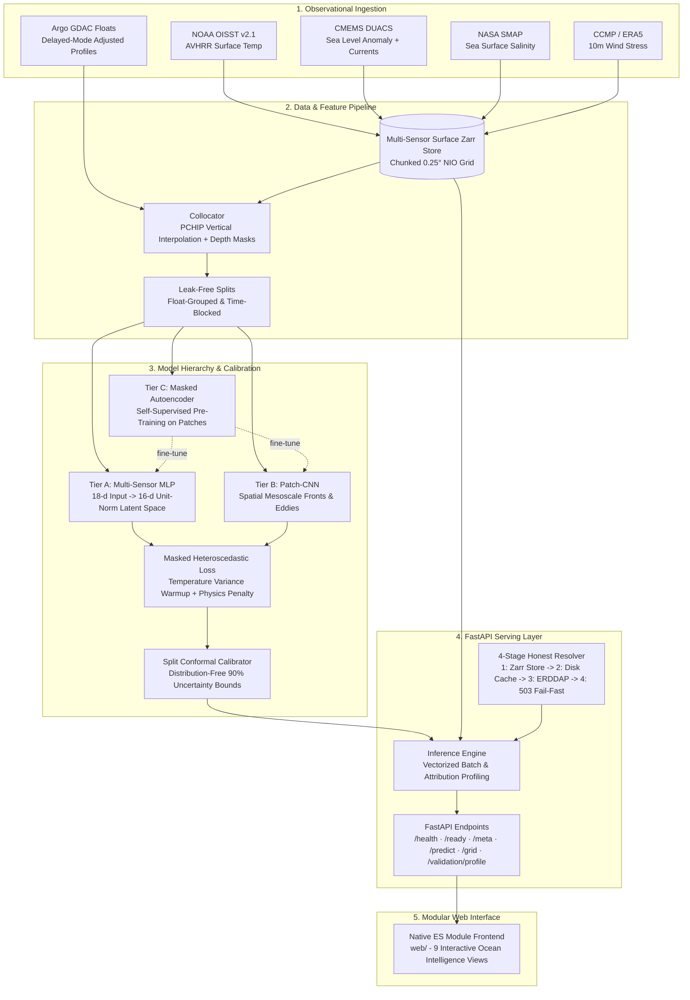

# System Architecture — AquaSphere (OceanEmbed)

> **Framework:** Multi-Sensor Satellite Embedding & Calibrated Subsurface Ocean Reconstruction  
> **Target Region:** North Indian Ocean ($5^\circ\text{–}30^\circ\text{N}, 45^\circ\text{–}105^\circ\text{E}$)  
> **Problem Statement:** SIH 26066 (MoES / INCOIS)

---

## 1. End-to-End System Pipeline



---

## 2. 4-Stage Honest Resolver Flow

To eliminate silent simulation, every observation lookup executes through a strict 4-stage hierarchy:

```text
Resolve(lat, lon, date):
   │
   ├─► 1. In-Memory LRU Cache: instant response (data_source = disk_cache)
   │
   ├─► 2. Local Zarr Surface Store: offline disk chunk query (data_source = local_store)
   │
   ├─► 3. On-Demand Disk Cache: verified SHA-256 cache hits (data_source = disk_cache)
   │
   ├─► 4. Live Satellite ERDDAP (if network enabled): fetches remote observation (data_source = live)
   │
   └─► 5. FAIL-FAST: Return HTTP 503 Service Unavailable (Silent simulation strictly prohibited)
```

---

## 3. Modular Frontend Architecture (`web/`)

- Built strictly with **native ES6 modules** (`<script type="module">`). Zero npm/webpack/vite build step required.
- **In-Flight Request Deduplication:** Tracks ongoing network promises in a central `Map<string, Promise>` to eliminate race conditions during rapid user clicks.
- **Dynamic Date Picker:** Range and bounds loaded from `GET /meta` rather than hardcoded dates.
- **Provenanced Visualizations:** Every chart displays an explicit badge indicating whether inputs came from `local_store`, `disk_cache`, `live`, or `offline_synthetic`.
